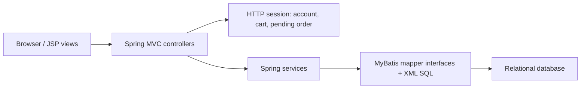

# Application architecture and verification map

## Scope

The active hackathon application is MyBatis JPetStore 6, a Java web app. It is not an IBM i application. The repository's COBOL examples are preserved reference material. This map reflects the checked-in source on `prep/jpetstore-bob`.

## Runtime path



- Controllers handle HTTP routes, session state, and view selection.
- Services hold application operations. `OrderService.insertOrder` is transactional.
- MyBatis mapper interfaces and XML statements perform SQL.
- The app's runtime database is configured by its Spring/MyBatis resources; the duplicate-order integration tests use embedded HSQLDB.

## Checkout and the fix

```mermaid
sequenceDiagram
  participant U as User
  participant C as OrderController
  participant S as OrderService
  participant D as Database
  U->>C: GET /order/new
  C->>C: Build Order from account + cart; save session["order"]
  U->>C: POST /order/new (confirmed=false)
  C-->>U: Confirmation view
  U->>C: POST /order/new (confirmed=true)
  C->>S: insertOrder(sessionOrder)
  S->>D: Allocate ID, update inventory, insert order/status/lines
  C->>C: Remove session["order"]; reset cart
  C-->>U: ViewOrder
  U->>C: Replay confirmation POST
  C-->>U: Error view; no second insert
```

Before the fix, the successful confirmation left `session["order"]` in the session, so replaying the confirmation POST called `insertOrder` again. The fix removes that session attribute only after the insert succeeds. The local `sessionOrder` variable remains available for the response view.

A fresh checkout cycle can create and confirm another order. The regression suite checks both cases:

- `replayConfirmPostInSameSessionMustNotInsertDuplicateOrder` — second confirmation does not add order or line-item rows or decrement inventory again.
- `secondLegitimateOrderInNewSessionCycleIsAccepted` — a later independent order is accepted.

## Evidence map

| Claim | Evidence |
|---|---|
| The replay path could insert twice before the fix | Before-fix Failsafe failure recorded in [VERIFICATION.md](VERIFICATION.md) |
| The fix blocks the replay | `OrderControllerDuplicateOrderIT`, after-fix run recorded in [VERIFICATION.md](VERIFICATION.md) |
| A legitimate later order still works | `secondLegitimateOrderInNewSessionCycleIsAccepted` |
| Existing unit tests remain green | 98-test Surefire result recorded in [VERIFICATION.md](VERIFICATION.md) |
| Bob's contribution | Not inferable from source or commit alone; record supported details in [BOB_WORKLOG.md](BOB_WORKLOG.md) |

## Repository map

- `jpetstore/src/main/java/.../web/controllers/` — HTTP routes and session handling.
- `jpetstore/src/main/java/.../service/` — business operations, including transactional order insertion.
- `jpetstore/src/main/java/.../mapper/` and `jpetstore/src/main/resources/.../mapper/` — persistence interfaces and SQL mappings.
- `jpetstore/src/test/` — unit and database-backed integration tests.
- Root `picclaus/` and `cobolinfo/` — original IBM i COBOL examples, not part of the active JPetStore runtime.

## Current boundary

The duplicate-order fix is implemented. No separate feature is implemented or selected in this repository snapshot. Confirm the hackathon rubric before deciding whether to add one.
